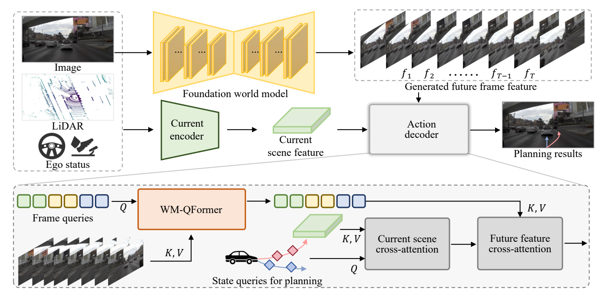

<div align="center">

# ForeSight

### See Tomorrow, Act Today:<br>Foresight-Driven Autonomous Driving

[](https://arxiv.org/abs/2605.07195)
[](https://github.com/LogosIntelligenceLab/ForeSight/blob/main/LICENSE.md)

[Bozhou Zhang](https://zbozhou.github.io/)<sup>1,2,&#42;</sup>,
[Nan Song](https://scholar.google.com/citations?hl=zh-CN&user=wLZVtjEAAAAJ)<sup>1,2,&#42;</sup>,
Yuang Wang<sup>1</sup>,
[Jiankang Deng](https://scholar.google.com/citations?user=Z_UoQFsAAAAJ&hl=zh-CN)<sup>3</sup>,
[Xiatian Zhu](https://scholar.google.com/citations?user=ZbA-z1cAAAAJ&hl=en)<sup>4</sup>,
[Li Zhang](https://lzrobots.github.io)<sup>1,2,†</sup>

<sup>1</sup> Fudan University &nbsp; · &nbsp;
<sup>2</sup> Shanghai Innovation Institute<br>
<sup>3</sup> Imperial College London &nbsp; · &nbsp;
<sup>4</sup> University of Surrey

<sub>&#42; Equal contribution &nbsp; · &nbsp; † Corresponding author</sub>

**Imagine the future. Plan the next move.**

</div>

---

## Overview

ForeSight studies planning through imagined futures. A foundation world model supplies future visual representations; a lightweight current-scene encoder adds present context. WM-QFormer compresses the future features, and a state-based decoder combines both sources to predict driving trajectories.

<p align="center">
  
</p>
<p align="center"><sub>Architecture overview from Figure 2 of the paper.</sub></p>

## Citation

If you find this work useful, please cite:

```bibtex
@inproceedings{zhang2026foresight,
  title     = {See Tomorrow, Act Today: Foresight-Driven Autonomous Driving},
  author    = {Zhang, Bozhou and Song, Nan and Wang, Yuang and Deng, Jiankang and Zhu, Xiatian and Zhang, Li},
  booktitle = {CVPR Findings},
  year      = {2026}
}
```

## Acknowledgements

We thank the authors and contributors of [NAVSIM](https://github.com/autonomousvision/navsim), [DiffusionDrive](https://github.com/hustvl/DiffusionDrive) and [Epona](https://github.com/Kevin-thu/Epona) for their open-source work.

## License

See [LICENSE.md](https://github.com/LogosIntelligenceLab/ForeSight/blob/main/LICENSE.md) for the repository license. Third-party components retain their respective licenses.
